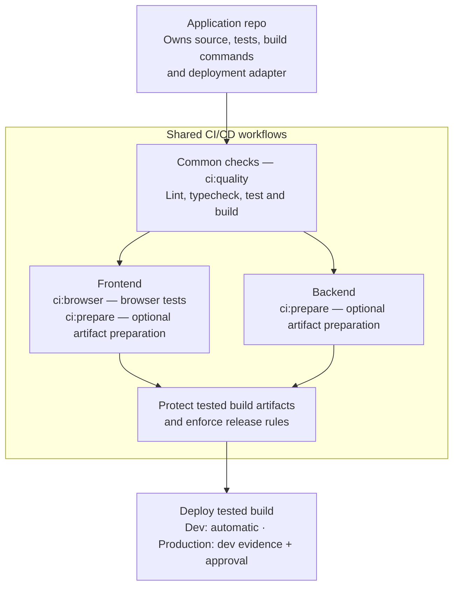

# CI/CD Workflows

Versioned GitHub Actions workflows for consistent testing and controlled delivery
of web frontends and Cloudflare Worker APIs.

Applications retain their source, tests and provider-specific adapters. This
repository supplies shared verification, artifact integrity and release guards.
PR verification is separate from main-to-dev delivery; production is a manual,
exact-source release with native approval.

## Workflow overview

Each application follows its matching frontend or backend path. Commands are
defined by the application and executed by the shared workflows. PR verification
stops before deployment.

The foundation uses Node.js, GitHub reusable workflows and explicitly pinned
Ubuntu 24.04 runners. See [the contract](docs/contract.md) for adoption, naming,
security boundaries and verification limits.
